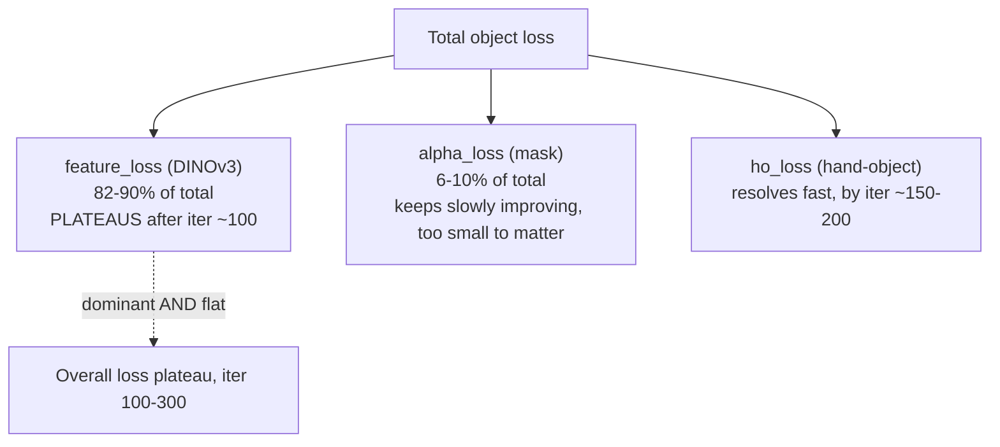

# Supervisor Weekly Update — HOI / AGILE Hand-Object Interaction Project

**Canonical copy**: this file, in your local working copy (`/Users/tamaghna/Desktop/HOI/supervisor_weekly_update.md`).
A synced copy is also committed to the project's git history on the KIAC cluster repo
(`hoi-agentic-reconstruction`, path `supervisor_weekly_update.md`) for backup/versioning — this
local file is what you edit and present from.

**Full experimental log** (the primary source of truth this document is built from): `plan.md`,
in this same folder, mirrored from the cluster repo.

---

# PART A — FRIDAY MEETING BRIEF

**Reporting date**: 2026-11-06 · **Period covered**: 2026-11-03 (project start) → 2026-11-06 (first briefing — no prior Friday report exists yet)

## A.1 Research overview

**Title**: Training-Free Video-to-3D Hand-Object Interaction (building on AGILE)

**Central research question**: Does AGILE's *existing* recovery/smoothness mechanisms — when
enabled vs. left at their released defaults — already close the gap that originally motivated a
proposed backtracking/hypothesis-search extension? Concretely: does adding smoothness
regularization (Condition B), or simply more optimization compute (Conditions C/D), or a
decaying learning-rate schedule (Condition E) measurably change AGILE's object-pose
reconstruction on a real hand-object sequence — before any new mechanism is built?

**Why it matters**: AGILE (and its predecessor HOLD) optimize hand/object pose per-frame without
any mechanism to revisit or revise an earlier frame's hypothesis once later evidence
contradicts it ("backtracking"). Before building and justifying such a mechanism, we need to
know whether the *existing*, already-released knobs (iteration budget, LR schedule, smoothness
loss) are actually the bottleneck, or whether something more fundamental in the loss landscape
is — because if it's the latter, a backtracking mechanism targeting pose history wouldn't
address the real problem.

**Proposed approach / intended contribution**: A controlled, single-variable experimental
sequence (Conditions A–E) isolating one released AGILE setting at a time, evaluated with
frame-to-frame temporal-consistency metrics, followed by root-cause diagnostic investigation of
*why* each lever did or didn't matter. The longer-term proposed contribution — a
persistent-contact/grasp-hypothesis backtracking mechanism with critic-driven state reversion —
remains a **research direction to validate**, not something implemented or claimed as achieved.
Prior literature/source review (recorded in `plan.md`, project start) found backtracking-with
-state-reversion absent from both AGILE and HOLD and from external prior art — supporting that
this would be a genuine contribution *if* it turns out to be needed.

**Current research stage**: Five controlled conditions (A–E) completed and analyzed. A
ground-truth-evaluation audit found no official geometric ground truth available locally
(see A.6). A loss-landscape root-cause investigation has just completed, redirecting the
research question from "does the optimizer's schedule/budget matter" to "why does the dominant
loss term stop moving after ~100–300 iterations."

## A.2 Executive summary

- **What happened this period**: Completed the full planned A–E experimental sequence on HO3D
  scene MC1, built and verified the entire AGILE environment/asset pipeline from scratch, ran a
  source-level diagnostic investigation of AGILE's convergence semantics, audited ground-truth
  availability, and completed a loss-decomposition investigation explaining *why* none of the
  five conditions changed the final reconstruction.
- **Most important result**: None of the three levers tested (added smoothness loss, 2–4x more
  iterations, or a decaying LR schedule) produced a reconstruction change larger than ~0.1–0.9%
  (noise level) in frame-to-frame object pose consistency. Root-cause analysis now explains why:
  the dominant loss term (`feature_loss`, a DINOv3 feature-correspondence loss, 82–90% of the
  weighted objective) itself goes nearly flat after ~100 iterations — none of the three levers
  touch that term, so none of them could have mattered.
- **Has the research direction changed?** Yes, in a focused way. The question has shifted from
  *"which optimizer-side knob fixes the gap?"* to *"is the gap caused by a genuinely flat loss
  landscape, an invisible cancellation between loss terms, or a stale cached feature-reference,
  and is ground truth even obtainable to check if any of this matters for actual accuracy?"*
  The broader backtracking/hypothesis-search contribution has not been started and remains
  gated on this diagnostic phase.
- **Single most important takeaway for supervisor**: We have a well-evidenced explanation for
  *why* three different interventions all failed to change the reconstruction — a dominant,
  weight-heavy loss term plateaus early — but we currently have **no way to check whether the
  resulting reconstruction is actually geometrically accurate**, because official HO3D ground
  truth was never downloaded to the cluster. This is now the key open decision (see A.8).

## A.3 Progress this week

| Area | What was completed | Evidence |
|---|---|---|
| Infrastructure | Built `agile-optim` conda env (CUDA 11.8, pytorch3d/manopth/cumesh2sdf from source), transferred + verified MANO, downloaded + verified DINOv3 (1.2GB), downloaded + verified MC1 dataset (897 frames) | plan.md §2026-11-03/04; jobs 73163, 73170, 73190, 73197, 73204, 73206 |
| Repro infra | Wrote `run_experiment.py` (config wrapper with single-field-diff assertion), `analyze_temporal_consistency.py` (no-GT metric, 5/5 self-tests passed) | commit `493cb07` |
| Experiments | **Condition A** (released baseline), **B** (+smoothness loss), **C** (+2x iters), **D** (+4x iters), **E** (+linear LR decay) — all completed, all outputs verified complete (16-file set, 40 frames each) | jobs 73230–73232, 73371, 73449; commits `3f8720e`…`bf2fcb9` |
| Diagnostics | Added observational per-iteration diagnostic logging (JSONL), verified via isolated smoke tests before each real run | commit `98a3042`; jobs 73371-smoke, 73447 |
| Investigation 1 | Source-level trace of AGILE's convergence-status semantics and an apparent "invariant hand rotation" anomaly — fully explained, not just observed | commit `386f9e8` |
| Investigation 2 | GT availability audit — determined official HO3D ground truth does **not** exist on this cluster | commit `3180d6f` |
| Investigation 3 | Loss-landscape decomposition — identified `feature_loss` as the dominant AND plateauing term; found the convergence threshold is miscalibrated for the object optimizer | commit `99b7ee5` |
| Repo | GitHub repository live and verified: `github.com/Tamaghna1/hoi-agentic-reconstruction`, 10 commits, dedicated SSH deploy key | commit `8111a5a` |

Everything above was *completed* with verified evidence (exit codes, output file checks,
numeric cross-checks) — not merely attempted or submitted. Two items that were **attempted and
failed, then diagnosed and fixed** are recorded as negative results in Part B §7, not hidden.

## A.4 Key results and evidence

### A.4.1 Does changing the optimizer's schedule/budget change the reconstruction?

| Condition | What changed vs. A | Object rotation Δ (median, rad) | Object translation Δ (median) | vs. A |
|---|---|---|---|---|
| A | — (baseline) | 0.17868 | 0.013007 | — |
| B | + smoothness loss (λ=2e-4) | 0.18042 | 0.013080 | +0.97% / +0.56% |
| C | + 2x object iterations (800) | 0.17998 | 0.013039 | +0.73% / +0.25% |
| D | + 4x object iterations (1600) | 0.17978 | 0.013039 | +0.61% / +0.25% |
| E | + linearly-decaying object LR | 0.18025 | 0.013105 | +0.88% / +0.75% |

**All differences are within ~0.1–1.0% of the baseline — noise level, not a material change.**
These numbers measure *temporal consistency* (how much the reconstructed pose changes
frame-to-frame), not *accuracy against ground truth* — see A.6.

### A.4.2 Why none of them mattered — the loss decomposition

| Iteration | `alpha_loss` (mask) | `feature_loss` (DINOv3) | `ho_loss` (hand-object) | Total | feature_loss share |
|---|---|---|---|---|---|
| 0   | 1.01 | 6.01 | 2.41 | 9.43 | 64% |
| 50  | 0.59 | 5.76 | 0.65 | 7.01 | 82% |
| 100 | 0.48 | 5.75 | 0.29 | 6.53 | 88% |
| 300 | 0.40 | 5.62 | 0.21 | 6.22 | 90% |
| 399 | 0.40 | 5.55 | 0.21 | 6.15 | 90% |

`feature_loss` is 82–90% of the total weighted objective, and it is also the term that stops
moving (5.75→5.55, a ~3.5% drop, across 300 further iterations). Everything else in the
objective is too small a share to move the total even while still improving. This pattern is
**identical in D and E** (within ~1% at every checkpoint) — explaining why a 4x iteration
budget and a 10x LR decay both failed to help: neither touches the term that's actually stuck.

### A.4.3 Is the optimizer actually converging, or just producing small updates?

Neither cleanly. The raw gradient magnitude (`gradient_inf`, independent of the LR schedule)
drops a genuine ~100–150x by iteration 300 in both D and E — real flattening, not an artifact
of E's imposed LR decay. But it never reaches zero (median ~1–3 at the final iteration) — a
**shallow plateau, not a true stationary point**. Separately, we found the object optimizer's
fixed convergence threshold (`converge_grad_tol=1e-3`) is ~1000x smaller than its actual
observed gradient scale, so the `'converged'` status is essentially unreachable for it — this
occurred **zero times** across all of D and E's object-optimizer runs (80 frame-optimizations
each). The hand optimizer, by contrast, does reach near-zero gradient under that same fixed
threshold — this is a calibration mismatch specific to the object optimizer, not evidence about
the hand.

## A.5 Interpretation and research implications

- **Hypothesis "more iterations closes the gap": not supported.** 4x the iteration budget (D)
  produced no material reconstruction change (A.4.1) and the loss decomposition shows why: the
  dominant term is already flat by iteration ~100 (A.4.2).
- **Hypothesis "a decaying LR schedule helps convergence": not supported for reconstruction,
  partially supported for optimizer bookkeeping only.** E's LR schedule genuinely decays
  (verified) and does make gradient/step-size behavior much smoother — but this did not change
  the final loss or trajectory. The large shift in E's convergence-status labels
  (`budget_exhausted`→`stalled_at_budget`) is a mechanical side-effect of forcing the LR down,
  not evidence of better optimization — we were careful not to over-claim this.
- **Hypothesis "smoothness regularization closes the gap": not supported, with an important
  caveat.** B's smoothness loss is correctly wired in and active, but its weighted magnitude
  rounds to 0.0000 at 4-decimal log precision on every one of 31,200 samples — i.e. it's at
  least an order of magnitude smaller than the co-active losses. We can't fully rule out a
  larger effect at a higher (untested) weight; we can only say the *released* weight is too
  small to matter here.
- **What remains uncertain**: whether `feature_loss`'s flatness reflects (a) a genuinely
  insensitive/saturated loss landscape, (b) cancellation between multiple loss terms hidden by
  only logging the *summed* gradient (we have no per-term gradient logging — a real
  instrumentation gap, not resolved evidence), or (c) staleness in the feature-similarity
  reference map, which is only refreshed every 20 iterations. None of these three are
  distinguished yet.
- **How this changes direction**: the research question has narrowed from "which optimizer
  setting helps" (now reasonably answered: none of the three tested) to "what in the loss
  itself is flat, and is that flatness even a problem for actual reconstruction accuracy" — the
  latter is currently unanswerable without ground truth (A.6).

## A.6 Current blockers and risks

| # | Issue | Status | Resolved? |
|---|---|---|---|
| 1 | **No official HO3D ground truth locally available.** Everything that looked GT-like on disk (`object_pose/`, `wilor/`) is confirmed to be FoundationPose/WiLoR *predictions* used only as optimizer initialization — never GT. AGILE's own docs confirm this was intentionally excluded from what we downloaded. | **Open — needs your input.** Official HO-3D_v3 release is ~32–67GB (public mirrors), over the project's own 1GB unprompted-download threshold. Whether a smaller annotations-only subset exists is unverified. | No |
| 2 | Per-component gradient conflict between loss terms is unmeasurable with current diagnostics (only the *summed* gradient is logged) | Open, a proposed next experiment would close this (A.7) | No |
| 3 | `converge_grad_tol` threshold is miscalibrated for the object optimizer (by ~1000x) | Diagnosed with clear evidence; not yet fixed (would require a config/code change, not yet authorized) | Diagnosed, not fixed |
| 4 | Initial import-path bug would have made all of A/B/C fail at launch | **Fixed** before any real run, caught by the smoke test | Yes |
| 5 | A/B/C's real outputs initially appeared missing (saved to an AGILE auto-generated path due to a `result_dir` config bug, not our intended isolated directories) | **Fixed and the bug's root cause documented**; no data was actually lost | Yes |
| 6 | Job 73170 (environment build) appeared possibly stalled on a slow package download for ~45 min | **Resolved** — confirmed genuinely slow network, not stalled; completed successfully | Yes |

**The only unresolved blocker requiring your decision is #1** — see A.8.

## A.7 Next week's research plan

| Priority | Task | Question it answers | Deliverable / success criterion | Dependencies / risks |
|---|---|---|---|---|
| 1 | **Decide on ground-truth acquisition** (needs your input — see A.8) | Can we ever validate geometric accuracy for this scene? | A decision: acquire full/partial HO3D GT, use a different GT-available dataset, or proceed GT-free | Download size (32–67GB) may need institutional bandwidth/storage sign-off |
| 2 | Add per-component gradient instrumentation, rerun a short smoke-test-scale diagnostic (not a new full condition) | Is `feature_loss`'s flatness genuine, or is it masked term-cancellation? | Per-term gradient norms logged; smoke-test-scale confirmation | Low risk, additive only, needs your authorization before running |
| 3 | (If #2 doesn't resolve it) Vary `compute_feature_every_iter` (20→1) on a short diagnostic run | Is some of the plateau caused by a stale cached feature-reference map? | Loss trajectory under constant refresh vs. current 20-iteration cache | Higher per-iteration compute; needs explicit sign-off since it changes a config field |
| 4 | Depending on 1–3's outcome: either proceed to the backtracking/hypothesis-search mechanism design, or investigate the loss formulation itself (DINOv3 feature correspondence quality) | Is the original motivating question (does a new mechanism beat existing AGILE knobs) still the right one to pursue? | A concrete go/no-go on the broader contribution | Depends entirely on 1-3 |

## A.8 Questions for your supervisor

1. **Ground truth**: Should we pursue acquiring official HO3D ground truth (32–67GB download,
   academic-license, would need your sign-off on storage/bandwidth), accept a smaller
   possibly-available annotation-only subset (unverified whether this exists), use a different
   GT-available benchmark instead, or continue without geometric validation for now and rely on
   temporal-consistency + diagnostic evidence only?
2. **Scope check**: Given that none of the three "more compute / better schedule" levers
   mattered, do you want us to continue down the loss-landscape diagnostic path (per-term
   gradients, feature-cache staleness), or pivot sooner toward the backtracking/hypothesis-search
   mechanism that originally motivated this project, treating the loss-plateau finding as
   sufficient justification on its own?
3. **MC1 scene suitability**: MC1 is confirmed (by direct visual inspection of the sequence) to
   be a single continuous in-hand rotation — no regrasp, no contact-topology change. If the
   eventual contribution is specifically about regrasp/contact-hypothesis backtracking, should we
   identify a different HO3D scene with an actual regrasp event before going further, or is
   MC1's continuous-rotation stress-test (increasing self-occlusion) sufficient for the next
   phase of this work?

## A.9 Suggested verbal presentation (5–10 minutes)

1. **Open with the question** (30s): "We wanted to know whether AGILE's existing
   optimization-side settings — more compute, a better LR schedule, smoothness regularization —
   already solve the problem that motivated our proposed backtracking idea, before building
   anything new."
2. **Describe the experiment** (1.5 min): Five controlled conditions (A–E) on one real HO3D
   sequence, each changing exactly one setting from the released baseline. Point out the
   infrastructure effort (env build, asset verification, isolated diagnostics) was substantial
   and is now fully reusable.
3. **State the headline result plainly** (1 min): None of the three interventions changed the
   reconstruction meaningfully — all differences are within ~1% of baseline, i.e. noise.
4. **Explain *why*, with the loss decomposition** (2 min): Walk through the `feature_loss`
   dominance table / diagram (A.4.2) — the DINOv3 feature-correspondence term is 82–90% of the
   objective and plateaus by iteration ~100, so nothing done to the optimizer schedule or budget
   could have mattered. Mention the convergence-threshold miscalibration finding as supporting
   evidence this is a real effect, not a mis-set stopping rule.
5. **Be upfront about the limitation** (1.5 min): We cannot currently say whether the resulting
   reconstruction is *accurate* — official ground truth for this scene was never downloaded to
   the cluster, and everything that looked GT-like on disk turned out to be model predictions
   used only for initialization. Temporal consistency (what we measured) is not the same claim
   as geometric accuracy.
6. **Close with the fork in the road** (1 min): either acquire ground truth (needs a sizing/
   access decision) and validate accuracy directly, or continue the loss-landscape diagnostic
   (per-term gradients, feature-cache staleness) to fully pin down the plateau's cause, or pivot
   toward the backtracking mechanism now that the "existing knobs are insufficient" question has
   a reasonably well-evidenced answer. Ask for their view on which to prioritize.

---

# PART B — DETAILED RESEARCH RECORD

## B.1 Research background and evolution of the question

The project began (2026-11-03) with a broader proposed contribution: a backtracking/
hypothesis-search mechanism for hand-object reconstruction, allowing earlier per-frame pose
estimates to be revised when later frames provide contradicting evidence (motivated by
persistent-contact/grasp-hypothesis reasoning). Before implementing this, a literature and
source review was conducted and concluded that **backtracking-with-state-reversion is confirmed
absent from both AGILE and its predecessor HOLD, and from external prior art searched** —
supporting that such a mechanism would be a genuine contribution if ultimately needed.

However, this same review found that AGILE's *released* configuration already has several
recovery/consistency mechanisms enabled by default (`recover_object_pose_from_mask=True`,
`bidirectional_optimization=True`, `ho_relpose_loss=True`, `object_feature_loss=True`), with
exactly one related toggle (`object_smoothness_loss`) left *off* by default. This narrowed the
immediate research question to: **does enabling the one disabled toggle, or simply giving the
optimizer more compute/a better schedule, already close the gap** — before justifying a new
backtracking mechanism. This is the question Conditions A–E were designed to answer.

## B.2 Experimental methodology and configurations

**Fixed experimental design** (`plan.md` "FROZEN RESEARCH DECISIONS", approved 2026-11-03):
- **Dataset**: HO3D scene MC1 (897 frames total, `contact_frame=10`). Chosen over scene MC4
  specifically because MC1's contact frame is non-zero, which exercises a genuine *backward*
  pass in AGILE's bidirectional optimization (MC4's contact frame is 0, which would never do so).
- **Window**: `start_frame=10, end_frame=200` (approved, frozen). This produces AGILE's
  bidirectional "hold mode" sampling: a 2-frame backward pass + 38-frame forward pass (stride 5),
  40 total output frames, output index `i` ↔ original video frame `5*i` (verified independently
  via the saved `prediction_frame_ids` metadata in two separate conditions).
- **Scene content, visually confirmed** (19+ frames inspected directly): a single continuous
  in-hand rotation of the object throughout the full 897-frame sequence — **no approach,
  release, regrasp, or contact-topology change anywhere**. Self-occlusion and rotation magnitude
  increase substantially from ~frame 150 onward. **This sequence does not and cannot demonstrate
  a regrasp/contact-hypothesis scenario** — it is useful as an in-hand-rotation/self-occlusion
  stress test only. This is an explicit, standing limitation, not an oversight.
- **Loading mechanism**: all five conditions load AGILE's *actual released* `configs/ho3d.json`
  plus MC1's scene overrides, then apply exactly one condition-specific delta, enforced by a hard
  assertion (`run_experiment.py`'s `assert_single_field_diff`) that fails the run if any other
  field differs from the baseline — this guarantees no accidental cross-contamination between
  conditions.

| Condition | Delta from released baseline (A) | Rationale |
|---|---|---|
| **A** | none (exact released config) | Baseline |
| **B** | `object_smoothness_loss=True` | Tests the one disabled released toggle |
| **C** | `object_max_iter_per_frame=800` (2x) | Compute-matched control for "more iterations helps" |
| **D** | `object_max_iter_per_frame=1600` (4x) | Extends C to check if the trend continues |
| **E** | `object_scheduler_type="linear"` (decaying LR, `LinearLR` end_factor=0.1) | Tests whether a decaying schedule (vs. flat/constant, the released default) helps, at A's original 400-iteration budget |

## B.3 A–E experiment history and comparisons

### Condition A (job 73230) — released baseline
COMPLETED, exit 0:0, elapsed 01:12:33. Real output saved to AGILE's auto-generated path
`results/MC1/1104_011226_mask5.0_feature10.0_typelocal_lastframe/aligned` (see B.7 for why — a
documented, fixed infrastructure bug, not data loss).

### Condition B (job 73231) — + smoothness loss
COMPLETED, exit 0:0, elapsed 00:57:10. Smoothness loss confirmed structurally active (31,200
`[Object] smoothness_loss=` print occurrences, vs. 0 in A and C) but its weighted magnitude
rounds to `0.0000` at 4-decimal log precision on every single occurrence — at least an order of
magnitude below the co-active `feature_loss` (~5.8) and `alpha_loss` (~0.4). No TensorBoard
writer was active for any condition, so the true unrounded magnitude is unrecoverable from
existing logs; this bounds, but doesn't eliminate, the possibility of a larger effect at a
higher (untested) weight.

### Condition C (job 73232) — 2x iterations
COMPLETED, exit 0:0, elapsed 01:59:23 (notably longer than A/B, consistent with 2x object
iteration budget). No material change in temporal-consistency metrics vs. A (+0.7%/+0.3%).

### Condition D (job 73371) — 4x iterations
COMPLETED, exit 0:0, elapsed 03:29:30. Counterintuitively, the proportion of object-frame
optimizations ending in `budget_exhausted` status *increased* with more iterations (A: 70% →
C: 80% → D: 95%) — the opposite of what "more iterations resolves budget exhaustion" would
predict. Root-caused (B.6) to the object optimizer's LR never decaying (flat `[0.002, 0.001]`
for the entire run) combined with the loss plateauing early — `budget_exhausted` vs.
`stalled_at_budget` ends up substantially determined by noise in the step-size at the exact
terminal iteration, not by genuine remaining progress. No material change in temporal
consistency vs. A (+0.6%/+0.25%).

### Condition E (job 73449) — decaying LR schedule
COMPLETED, exit 0:0, elapsed 01:11:20. Full details on scheduler selection, verification, and
findings in `plan.md`'s "CONDITION E" section. Headline: LR genuinely decays (verified, ratio
0.1001–0.1003 across all 40 object-frame runs), step-size behavior is far smoother than D's, and
the `budget_exhausted`/`stalled_at_budget` mix flips almost entirely (D: 95%/5% →
E: 2.5%/97.5%) — but this flip is a **mechanical consequence** of forcing the LR down (it
pushes step-size under the fixed threshold regardless of real progress), not evidence of a
better optimum. Confirmed via matched-frame comparison with D (B.6): the two conditions reach
the same loss to within ~0.76% median per-frame difference at equal iteration count. No material
change in temporal consistency vs. A (+0.88%/+0.75%).

## B.4 Technical implementation and infrastructure milestones

| Date | Milestone | Commit |
|---|---|---|
| 2026-11-03 | MC1 dataset downloaded & verified (897/897 frames) | — |
| 2026-11-03 | MANO asset transferred (SHA-256 verified) and prepared | — |
| 2026-11-04 | `agile-optim` environment built (CUDA 11.8, pytorch3d/manopth/cumesh2sdf from source), independently verified with real GPU execution, not just exit code | — |
| 2026-11-04 | DINOv3 checkpoint downloaded (1.2GB) and numerically verified (exact patch/token-count match) | — |
| 2026-11-04 | Integrated smoke test passed (after fixing one import-path bug that would have affected A/B/C too — caught before any real run) | — |
| 2026-11-04 | GitHub repository live, dedicated SSH deploy key configured | `493cb07`, `8111a5a` |
| 2026-11-04 | `result_dir` output-isolation bug found and fixed (A/B/C's real outputs were saved to an AGILE auto-generated path, not the intended isolated directories — no data lost, fully traced) | `3f8720e` |
| 2026-11-04 | Conditions A, B, C completed; full temporal-consistency analysis | `d319f3d` |
| 2026-11-04 | Source-level diagnostic investigation (convergence semantics, hand-rotation-invariance anomaly explained) | `386f9e8` |
| 2026-11-04 | Condition D + observational diagnostic logging (JSONL) added, smoke-tested before real use | `98a3042` |
| 2026-11-04 | Condition D results recorded | `56f27cd` |
| 2026-11-05 | Condition E results recorded | `bf2fcb9` |
| 2026-11-05 | GT availability audit recorded | `3180d6f` |
| 2026-11-05 | Loss-landscape investigation recorded | `99b7ee5` |

## B.5 Evaluation methodology and limitations

**Temporal-consistency metric** (`scripts/analyze_temporal_consistency.py`, self-tested 5/5
against synthetic cases before any real use): for each condition, computes frame-to-frame SO(3)
geodesic rotation deltas and Euclidean translation deltas for the object, plus hand joint/vertex
displacement, directly from AGILE's own saved `object_poses.npz`/`mano_transforms.npz` arrays.
**This measures how much the reconstruction changes between adjacent frames — it does not and
cannot measure whether the reconstruction is correct.** A smoother trajectory is not, by itself,
evidence of improved accuracy; a noisier one is not evidence of worse accuracy. This limitation
was stated explicitly at the start of the project and has governed every subsequent report.

**Ground-truth evaluation — audited, blocked** (commit `3180d6f`, full report in `plan.md`):
- Official HO3D annotations (`meta/*.pkl` with object pose, hand MANO params/joints, object CAD
  models) do **not** exist anywhere on this cluster. AGILE's own installation docs confirm this
  was intentionally excluded from the data download used for optimization-only workflows.
- Everything present under `object_pose/` and `wilor/` in the dataset directory is a model
  **prediction** (FoundationPose's and WiLoR's own outputs), used only as optimizer
  initialization — never ground truth. Treating these as GT was explicitly ruled out as circular.
- AGILE ships a real, implemented evaluation protocol (Chamfer distance variants, MPJPE
  variants) in `optimization/evaluation/protocols.py`, but its own validation code hard-requires
  a genuine GT validity mask and matching frame IDs with no fallback — so **zero metrics are
  currently computable**, not due to ambiguity but because the required inputs don't exist.
- Frame correspondence (output index → original video frame) and coordinate conventions **are**
  fully verified and evaluation-ready, independently cross-checked across two conditions — so if
  GT is ever acquired, the rest of the evaluation pipeline does not need to be re-derived.

## B.6 Important decisions and their justifications

- **MC1 over MC4**: MC1's non-zero contact frame exercises bidirectional optimization's backward
  pass; MC4 would not.
- **Window 10–200 over a narrower window**: visually confirmed to capture genuine increasing
  rotation/self-occlusion (the scientifically interesting regime), at the cost of ~4x more
  compute than a narrow window.
- **Scheduler choice for E (`"linear"`)**: selected as the simplest supported, genuinely-decaying
  option (`LinearLR`, no extra config fields needed) over `"sequential"` (multi-phase, already
  used by the hand optimizer) or `"exponential"` (requires deriving a gamma parameter) — chosen
  deliberately to isolate one clean variable.
- **Diagnostic logging introduced for D, reused unchanged for E**: an env-var-gated, strictly
  observational JSONL logger reading only already-computed values — verified via isolated smoke
  tests to introduce zero behavior change before being trusted for real conditions.
- **GT evaluation gated, not attempted with substitutes**: when the audit found no GT, the
  explicit decision was to stop and report rather than use FoundationPose/WiLoR predictions as a
  stand-in — avoiding a circular "does AGILE agree with its own initialization" result that would
  have been presented as if it were an accuracy check.

## B.7 Failed experiments and negative results

Presented constructively — what was tested, what was observed, what was learned:

1. **Import-path bug (job 73209, smoke test attempt 1)**: FAILED in 13s on an incorrect import
   statement. **What we learned**: the identical bug existed in the already-approved A/B/C
   wrapper script, hidden behind `--check-only`'s early exit — meaning all three real conditions
   would have failed identically at launch had the smoke test not caught it first. Fixed in both
   scripts before any real run; no research setting was touched.
2. **A/B/C output-isolation bug**: A/B/C's real outputs were initially found saved to an AGILE
   auto-generated path (`results/MC1/<timestamp>_.../aligned`) instead of the intended isolated
   per-condition directories. **What we learned**: `Config.result_dir` was never explicitly set
   in the wrapper, so AGILE silently fell back to its own naming scheme. Fixed for D/E onward
   (`build_effective_config()` now sets it explicitly). No data was lost — careful, read-only
   investigation (checking `.bash_history`, grepping for destructive commands, cross-referencing
   each run's own "Saving optimized data to..." log line) confirmed this before concluding
   anything, rather than assuming the worst.
3. **B's smoothness loss — a genuine, reportable null result**: structurally active, correctly
   weighted, fires on every eligible frame — but produces no measurable change in temporal
   consistency, most likely because the released weight (2e-4) is too small relative to the
   other co-active losses (5.0 / 10.0 / 400.0) to matter. Presented as a weight-magnitude finding,
   not as "smoothness regularization doesn't work."
4. **C/D's iteration-budget increase — a genuine, reportable null result**, with a
   counterintuitive secondary finding (budget_exhausted proportion *increasing* with more
   iterations) that was root-caused rather than left as a puzzle (B.3).
5. **E's LR-decay — a genuine, reportable null result for reconstruction**, with the important
   caveat that it does materially change internal optimizer bookkeeping (convergence-status
   labels) without changing the actual output — explicitly flagged as not evidence of improvement.
6. **Job 73170 "possible stall"**: at ~32 minutes elapsed with no new log output, investigated
   (pip cache growth, process state) rather than cancelled reflexively; confirmed genuinely slow
   network (not stalled) at the 46-minute mark. **What we learned**: a documented decision
   threshold (45–50 min) prevented a premature cancel/resubmit cycle.

## B.8 Unresolved hypotheses and future research opportunities

From the loss-landscape investigation (commit `99b7ee5`), explicitly separating what's
demonstrated from what's still open:

| Hypothesis | Status |
|---|---|
| `feature_loss` saturation drives the plateau | **Demonstrated** |
| Shallow/poorly-conditioned landscape (gradient flattens but doesn't vanish) | **Demonstrated** |
| Convergence threshold miscalibrated for the object optimizer | **Demonstrated** |
| Conflicting loss-term gradients (cancellation hidden by only logging the summed gradient) | **Untestable with current diagnostics — open** |
| Stale cached feature-reference map (refreshed only every 20 iterations) contributing to flatness | **Plausible, source-supported, not isolated — open** |
| WiLoR/FoundationPose initialization quality | **Plausible, unmeasurable without GT — open** |

**Future opportunities** (none authorized/run yet):
1. Per-component gradient instrumentation (closes the "conflicting gradients" gap) — proposed as
   the highest-priority next diagnostic step.
2. Vary `compute_feature_every_iter` to isolate staleness as a contributor.
3. Acquire ground truth (full or partial HO3D release) to finally test geometric accuracy, which
   nothing in A–E has measured.
4. Pending the above: either investigate the DINOv3 feature-correspondence loss formulation
   itself, or proceed to designing the backtracking/hypothesis-search mechanism that originally
   motivated this project — now with solid evidence that existing AGILE optimizer-side knobs are
   not the bottleneck.

## B.9 Archive of previous Friday briefs

*(None yet — this is the first briefing. Future updates will archive each superseded Part A
section here, dated, rather than deleting it.)*
